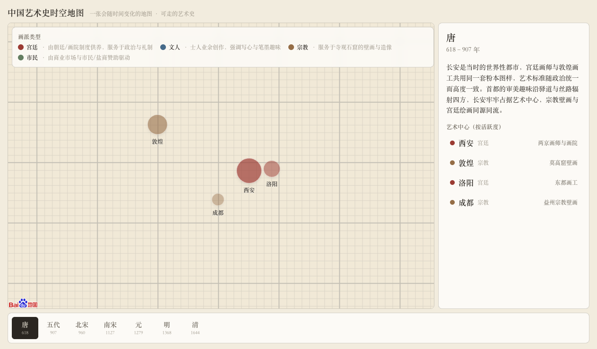
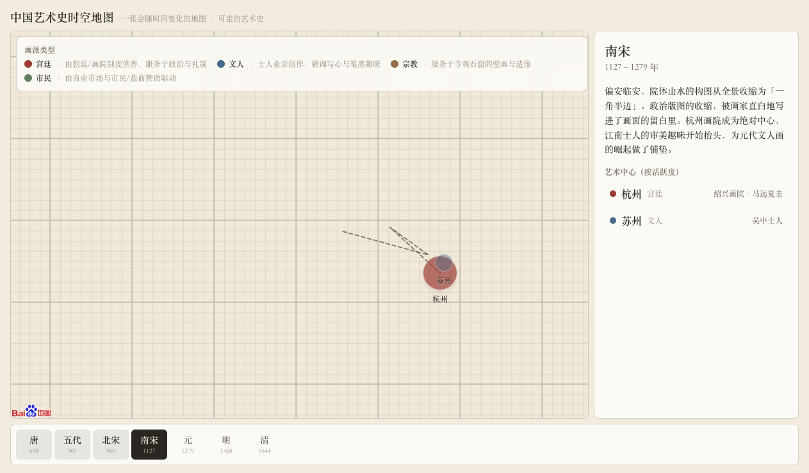

# 中国艺术史时空地图


> 一张会随时间变化的地图，三分钟看懂「中国美术的中心为什么一路往南走」。

## 这是什么

**时间 × 空间双轴叙事**的中国艺术史可视化作品。拖动底部朝代时间轴（唐 → 五代 → 北宋 → 南宋 → 元 → 明 → 清），地图上的艺术中心气泡随朝代变化、迁移轨迹线一路向南生长；点任意城市，展开它在该朝代的画派、时代背景、代表画家与今日可看的博物馆。

核心史学观点：**中国美术中心沿三条逻辑南移**——先跟着首都走（**政治**），后来跟着文人走（**文化**），最后跟着市场走（**经济**）。主线：长安 → 南京 → 开封 → 杭州 → 苏州 → 北京。

| 默认「唐」 | 切到「南宋」 |
| :---: | :---: |
|  |  |

## 功能

| 模块 | 说明 |
| --- | --- |
| 中国地图 | 百度地图 JavaScript API 2.0 为主底图；内置自绘 SVG 中国地图（34 省级行政区省界）作为兜底，无 AK / 加载失败时自动切换 |
| 朝代时间轴 | 7 个朝代，支持点击、键盘 ← →、移动端滑动；▶ 自动播放，每 2.5s 前进一朝，到「清」停止 |
| 艺术中心气泡 | 半径与透明度随「活跃度」权重变化，四色区分画派（宫廷 / 文人 / 宗教 / 市民） |
| 迁移轨迹线 | 随朝代推进描边生长，直观呈现「中心南移」 |
| 主线导读 | 「为什么一路往南」面板，讲清政治 / 经济 / 文化三条逻辑 |
| 详情面板 | 画派介绍 + 时代背景 + 代表画家（生卒年 / 代表作 / 收藏机构）+ 今日可看的博物馆 |
| 博物馆导航 | 25 个博物馆带精确坐标，一键跳百度地图定位；作品收藏机构可点馆名导航 |
| 全局搜索 | 搜画家 / 城市 / 画派，点结果直接跳到对应朝代与城市 |
| 画派筛选 | 点图例类型过滤气泡 |
| 分享海报 | 一键生成「我在某朝代的某城」卡片，可保存图片或调用系统分享 |
| 阿素语音 | 讲解员「阿素」全程语音，41 条预生成 mp3 随包发布，手动点播；缺音频时回落浏览器朗读 |
| AI 讲解 | 点城市生成口语化讲解词（常规 / 细一点 / 给孩子听），并用阿素音色朗读（需可选后端） |
| 响应式 | <640px 时地图 / 信息区 / 时间轴纵向堆叠，已验证 390 / 768 / 1280 / 1440 四档宽度 |

## 项目状态与已知问题

- 阶段 3（正式前端，4 个子阶段）已完成：视觉落地 → 功能增强 → 地图与博物馆 → 全局搜索与画派筛选。每阶段均有 [证据包](./evidence/阶段3/) 与自动化检查记录。
- **已知问题**：百度地图瓦片 CDN 曾返回 403，已定位为 **AK 授权 / Referer 白名单问题**（主 API 正常），非代码缺陷，需在百度地图开放平台控制台修复。项目为此内置了不依赖瓦片的离线 SVG 地图兜底，期间全部功能仍可完整体验。上线前需把白名单从 `localhost` 改为正式域名。
- **计划**：部署到腾讯云 EdgeOne Pages 静态托管（决策 D9）。
- 完整进度、决策台账与阶段历史见 [项目状态.md](./项目状态.md)。

## 技术栈

| 层 | 选型 |
| --- | --- |
| 前端 | Vite 8 · React 19 · TypeScript 6（strict）· Tailwind CSS 4 |
| 地图 | 百度地图 JavaScript API 2.0（图片瓦片版）+ 内置 SVG 兜底 |
| 状态 | React hooks（核心状态仅 `currentDynasty`） |
| 测试 | Vitest 5 + Testing Library + jsdom（数据校验 / 状态映射 / 组件）· oxlint |
| 语音 | 硅基流动 CosyVoice2 预生成 mp3（41 条），`tools/gen_audio.py` 可重新合成 |
| AI 讲解（可选） | 硅基流动 DeepSeek-V3 + CosyVoice2，经极简 Node 后端代理，Key 只留服务端 |
| 数据 | 静态 JSON 随包发布，无数据库、无用户系统 |

## 目录结构

```
china-art-history/
├── PRD/中国艺术史时空地图_PRD.md   # 产品需求文档
├── 项目状态.md                      # 进度与决策台账
├── DEMO.md                          # Demo 说明与演示脚本
├── 阶段文档/                        # 技术适配声明、前端技术适配声明、开发文档
├── evidence/阶段3/                  # 证据包、桌面截图、各子阶段验收记录
├── backend/
│   ├── server.mjs                   # 可选：AI 讲解 / TTS 代理
│   └── .env.example
└── frontend/
    ├── src/
    │   ├── components/              # 地图、时间轴、详情、图例、搜索、海报、讲解员等
    │   ├── data/                    # 静态 JSON + 加载与 schema 校验
    │   ├── hooks/ · utils/          # 朝代状态、语音、坐标投影、百度导航、搜索、海报
    │   ├── App.tsx
    │   └── constants.ts             # 画派四色 / 主线三逻辑定义
    ├── public/
    │   ├── audio/host/              # 「阿素」预生成语音 mp3
    │   └── img/host/                # 讲解员形象
    ├── tools/gen_audio.py           # 语音重新合成脚本
    ├── demo-线上版.zip              # 可直接解压预览的静态版本
    ├── .env.example
    ├── vite.config.ts               # /api 代理到 AI 讲解后端
    └── package.json
```

## 快速开始

### 1. 前端（必需）

```bash
cd frontend
npm install
cp .env.example .env      # 填入 VITE_BAIDU_AK（百度地图浏览器端 AK）
npm run dev               # http://localhost:5173
```

百度地图 AK 申请：百度地图开放平台 → 控制台 → 创建应用（类型选「浏览器端」）→ 配置 **Referer 白名单**（本地开发临时填 `localhost`，上线后改成正式域名）。

> **没有 AK 也能跑**：把 `VITE_BAIDU_AK` 留空即可自动切换到离线 SVG 中国地图，不弹百度报错窗，气泡、时间轴、详情、搜索、海报等交互照常可用。

### 2. AI 讲解后端（可选）

只有「AI 讲解」功能需要它；「阿素」预置语音是随包 mp3，无需 Key 即可播放。

```bash
cd backend
cp .env.example .env      # 填入 SILICONFLOW_API_KEY
PORT=3002 node server.mjs
```

> **端口要对齐**：`frontend/vite.config.ts` 把 `/api` 代理到 `http://localhost:3002`，而 `server.mjs` 默认监听 3001，因此启动时需显式指定 `PORT=3002`（或自行修改代理配置）。

## 环境变量

| 变量 | 位置 | 说明 |
| --- | --- | --- |
| `VITE_BAIDU_AK` | `frontend/.env` | 百度地图 Web 端公开 AK；配 Referer 白名单防盗用；留空走离线 SVG。**严禁把服务端 AK 写入前端** |
| `SILICONFLOW_API_KEY` | `backend/.env` | 硅基流动 Key，仅用于 AI 讲解 / TTS，不进前端产物 |
| `SILICONFLOW_LLM_MODEL` | `backend/.env` | 默认 `deepseek-ai/DeepSeek-V3` |
| `SILICONFLOW_VOICE` | `backend/.env` | 默认 `FunAudioLLM/CosyVoice2-0.5B:claire` |
| `PORT` | 命令行 / 环境 | AI 讲解后端端口，默认 `3001`；配合 vite 代理请设为 `3002` |

两个 `.env` 均已被 gitignore，仓库里只保留 `.env.example` 模板。

## 数据与校验

静态 JSON 随包发布，包含 **7 个朝代 / 13 座城市 / 26 个艺术中心 / 37 位画家 / 25 个博物馆**：

- `src/data/dynasties.json` · `places.json` · `centers.json` · `figures.json` — 朝代、城市、艺术中心、画家（含博物馆与画派介绍）
- `src/data/china.json` — 简化省界 GeoJSON，供离线 SVG 地图使用
- 坐标统一 **BD-09**；启动与测试时执行 schema 校验：`coordSystem=BD09`、`weight ∈ [0,1]`、`type ∈ {宫廷, 文人, 宗教, 市民}`、朝代叙事 80–120 字、经纬度在合理区间

> 「活跃度」权重是**主观赋值**，用于表达相对重要性，不是绝对量化指标；文案统一用「活跃度」措辞并标注依据来源。

画派四色与主线三逻辑定义集中在 `src/constants.ts`：政治=宫廷、文化=文人、经济=市民。

## 自动化检查

```bash
cd frontend
npm run lint        # oxlint
npm run typecheck   # tsc -b
npm run test        # vitest run（数据校验 + 状态映射 + 组件）
npm run build       # tsc -b && vite build → dist/
```

浏览器人工验收清单（含离线兜底、自动播放、响应式四档宽度）见 [frontend/README.md](./frontend/README.md) 与 [DEMO.md](./DEMO.md)。

## 部署

纯静态站点：`npm run build` 产出 `frontend/dist/`，可托管到任意静态服务（项目计划用腾讯云 EdgeOne Pages）。仓库另附 `frontend/demo-线上版.zip`，解压即可预览。

上线前记得把百度地图 AK 的 Referer 白名单从 `localhost` 改成正式域名，否则线上瓦片会返回 403。

## 文档索引

- [DEMO.md](./DEMO.md) — 产品说明、功能清单与演示脚本
- [frontend/README.md](./frontend/README.md) — 前端详细启动 / 验证 / 数据说明
- [项目状态.md](./项目状态.md) — 当前阶段、决策台账、阶段历史
- [PRD/中国艺术史时空地图_PRD.md](./PRD/中国艺术史时空地图_PRD.md) — 产品需求文档
- [evidence/阶段3/](./evidence/阶段3/) — 证据包、截图与阶段闸门是否表

## 说明与许可

本项目为「百度地图」主题比赛作品，主底图为百度地图 JavaScript API 2.0。数据为静态整理，不含用户采集；MVP 不做登录、收藏与后端数据库。

[MIT](./LICENSE)
